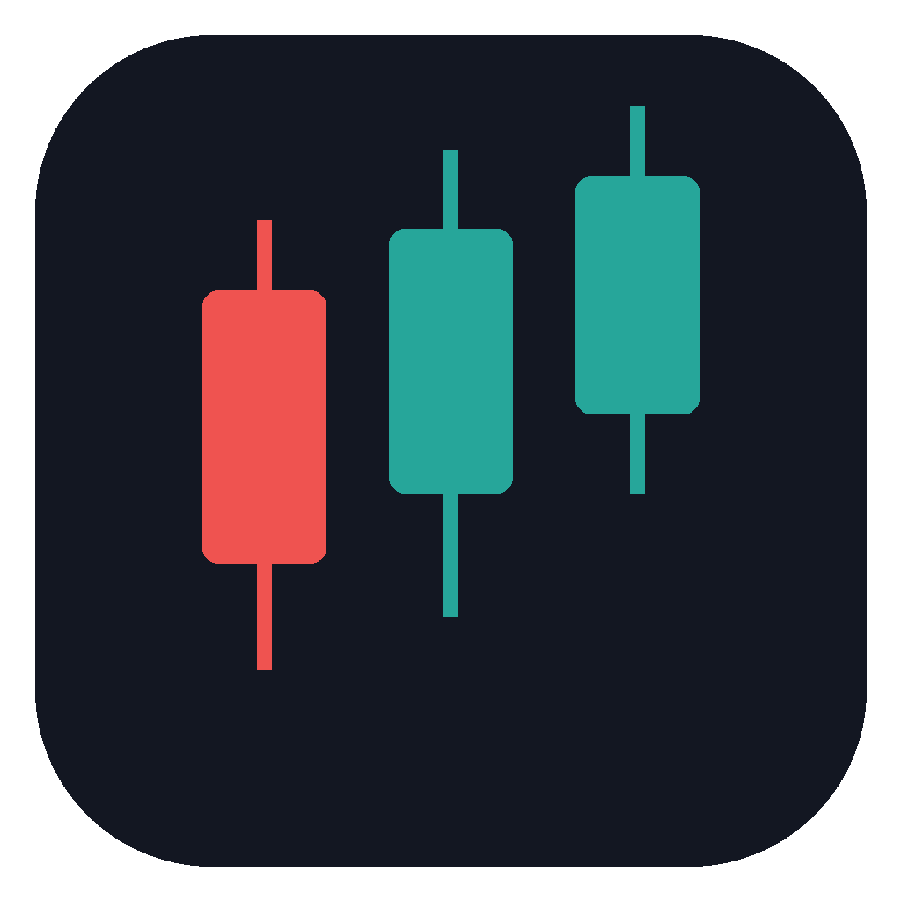
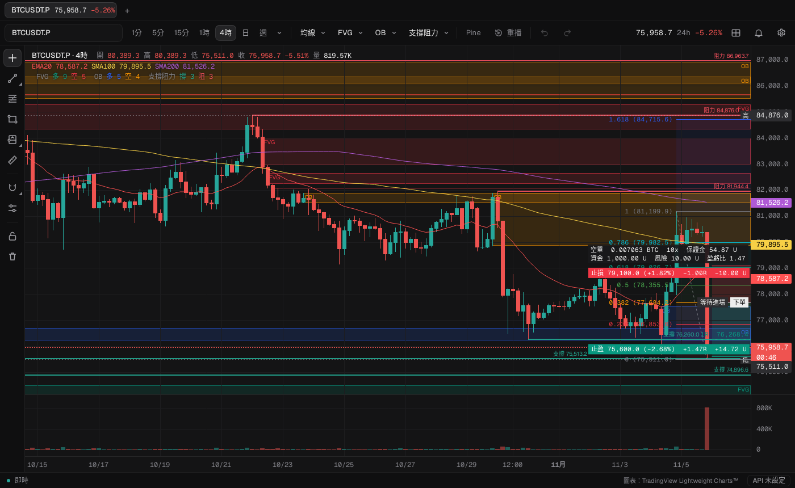

<p align="center">
  
</p>

<h1 align="center">QT Chart</h1>

<p align="center">OKX USDT 永續合約的桌面看盤與下單軟體，操作方式接近 TradingView</p>

<p align="center">
  <a href="https://github.com/chainchen1103/QT_chart/releases/latest"></a>
  
  
  
</p>



QT Chart 用 Rust 和 Tauri 2 當底層，用 TradingView 的 Lightweight Charts 畫圖。行情來自 OKX 的公開 API，看盤不需要帳號。設定 OKX API 之後，可以從圖上畫好的倉位直接下單，倉位大小照你設定的風險自動算。

## 目錄

- [特色](#特色)
- [下載安裝](#下載安裝)
- [快速上手](#快速上手)
- [功能說明](#功能說明)
- [快捷鍵](#快捷鍵)
- [從原始碼建置](#從原始碼建置)
- [專案結構](#專案結構)
- [安全性](#安全性)
- [資料存放位置](#資料存放位置)
- [常見問題](#常見問題)
- [授權與致謝](#授權與致謝)
- [之後可能加入](#之後可能加入)

## 特色

- **像 TradingView 的操作**：分頁、分割畫面、畫線工具、快捷鍵、價格標籤都照 TradingView 的習慣。
- **任意週期**：秒、分、時、日、週，OKX 沒有的週期會用較小的 K 線湊出來。
- **多週期指標**：均線、FVG、Order Block、支撐阻力，每一組都能指定用哪個週期算。
- **倉位工具**：照風險算數量，模擬結算，支援加倉合併和資金接續。
- **從圖上下單**：掛單、只做 Maker、市價，止損一定跟單送出。未成交的掛單直接拖動就能改價。
- **與 OKX 同步**：持倉、止損止盈、平倉結果即時畫在圖上。
- **價格提醒**：價格和畫線提醒，跳 Windows 通知，沒開在圖上的幣種也會盯。
- **Pine Script**：貼上 TradingView 的指標或策略就能跑，含策略回測。
- **K 線重播**：從過去任一根開始逐根播放。
- **AI 連線**：內建 MCP 伺服器，Claude、Cursor、VS Code 等 AI 應用程式可以讀圖、畫線，經你允許後也能下單。

## 下載安裝

1. 到 [Releases](https://github.com/chainchen1103/QT_chart/releases/latest) 下載最新的 exe。
2. 放到任何資料夾直接執行，不用安裝。Windows 10、11 已內建需要的 WebView2。
3. 第一次執行時 Windows 可能顯示「Windows 已保護您的電腦」，按「其他資訊」再按「仍要執行」。

所有設定和畫線存在這台電腦，換新版的 exe 也還在，詳見[資料存放位置](#資料存放位置)。

## 快速上手

1. 在左上角的搜尋框輸入幣種，例如 `ETH`，按 Enter。
2. 在工具列選週期，按「均線」「FVG」「OB」「支撐阻力」開關指標。
3. 用左邊的工具畫線。按 Alt+P 選倉位工具，依序點進場、止損、止盈，就會算出數量和盈虧比。
4. 要下單時，按右下角的「API 未設定」輸入 OKX API，再按倉位右邊的「下單」。
5. 要讓 AI 操作 QT Chart，打開「設定 → AI 連線」，照 [MCP 說明](docs/MCP_GUIDE.md)接上你的 AI 應用程式。

## 功能說明

### 圖表與週期

- K 線和成交量，成交量在下方獨立一格，可以拖動分隔線調高度。
- 工具列放常用週期，旁邊的選單列出全部週期：秒、分、時、日、週。按星號把週期放上工具列，也能輸入數字加單位自己新增，例如 7 分、90 分、18 時。
- OKX 原生的週期直接用 OKX 的 K 線。其他週期用能整除它的最大 OKX K 線湊成，歷史和即時都一樣，以 UTC 對齊，週從星期一開始。
- 時間軸顯示本地時間。
- 往左拖會自動載入更早的 K 線。每個圖表預設最多 20,000 根，設定裡可以改成無上限。
- 左上角顯示十字線那根 K 線的開高低收、漲跌幅、成交量和均線值。
- 右邊價格標尺按右鍵，可以開關最新價、收線倒數、均線數值、畫面內高低點、十字線價格、成交量數值。
- 圖上的標籤會自動讓位，不會互相重疊。

### 分頁與分割畫面

- 最上面一排是分頁，每個分頁顯示幣種、最新價和 24 小時漲跌，最多 20 個。拖曳可以換順序。
- 每個分頁可以分割成 1 到 4 個圖表，共 14 種版面。每個圖表各自選幣種和週期。
- 點一下圖表就換成使用中的圖表，工具列和畫線工具都作用在它上面。
- 拖曳分隔線調整大小，雙擊分隔線恢復平分。
- 畫線依幣種存。同一個幣種開在兩個圖表上，在一邊畫，另一邊也會出現。

### 指標

| 指標 | 說明 |
|---|---|
| 均線 | 最多 10 條，SMA、EMA 或 WMA，1 到 1000 根。高週期的均線畫成階梯線，預設等那根高週期 K 線收完才更新 |
| FVG | 第一根和第三根 K 線之間的缺口，可選看影線或實體。價格穿過整個缺口就算回補。最多 4 組 |
| Order Block | 收盤突破波段高點時，往前找最後一根陰線框住它的高低點，跌破時方向相反。收盤穿過就失效。最多 4 組 |
| 支撐阻力 | 波段高點畫成阻力線，波段低點畫成支撐線，收盤突破就失效。最多 4 組 |

每一組指標都能選用哪個週期算。預設跟著圖表週期，也可以固定，例如在 15 分圖上看 4 小時的 EMA50 或日線的支撐阻力。

### 畫線工具

左邊直排依序是：游標、線和通道、Fib 回撤、矩形、倉位、測量、吸附、Fib 數值設定、鎖定畫線、刪除全部畫線。

- **線**：趨勢線、射線、延長線、資訊線、趨勢角度、水平線、水平射線、垂直線、十字線。
- **通道**：平行通道、平頂平底、不相交通道、迴歸趨勢。迴歸趨勢會標出標準差通道和皮爾森相關係數。
- **Fib 回撤**：數值可以新增、刪除、改顏色，所有 Fib 共用。
- **矩形**：邊框、填色、透明度，可以向右延伸。
- **測量**：按尺規，或按住 Shift 點圖表空白處，標出漲跌、百分比、根數、時間和成交量。
- **吸附**：點靠近 K 線的開高低收時會吸過去。可以常開，或按住 Ctrl 暫時吸附。
- **Shift**：畫線和拖曳時鎖成水平、垂直或 45 度，矩形變正方形。
- **選取和移動**：點一下畫線就選取。矩形、倉位框和通道的內部要先選取才能拖，沒選取時在裡面拖曳會移動圖表，放大到整個畫面都在畫線裡也能平移。端點和線條隨時可以直接拖。
- **改樣式**：雙擊或右鍵點畫線，改顏色、粗細和線型，之後新畫的同種畫線會沿用。
- **還原和重做**：工具列的箭頭，或 Ctrl+Z、Ctrl+Y。每個幣種各記 100 步。
- **鎖定畫線**：按鎖頭後，畫線不能新增、移動、修改或刪除。雙擊畫線仍能查看和設提醒，從現有倉位下單照常可用。

### 倉位與風險

- 依序點進場、止損、止盈。止損在進場下面是多單，在上面是空單。
- 畫出獲利區、虧損區和 R 線，預設 1R、1.5R、2R，可以自訂。
- 數量等於風險金額除以進場到止損的距離。風險可以填資金的百分比或固定金額，槓桿 1 到 125 倍。保證金超過資金時會自動減量並提醒。
- 雙擊倉位可以直接輸入進場、止損、止盈的價格，價格會對齊幣種的最小跳動。
- 結算：進場價當成掛單，碰到才成交，之後先碰到止損或止盈就出場。同一根兩邊都碰到算止損。
- 資金接續：沒有自己填資金的倉位，用前一個倉位結算後的資金。
- 加倉：同方向的倉位在前一筆還沒出場時成交，會自動合成一筆，整筆的風險維持在設定值。
- 盈虧一律也寫成 R 倍數，例如 +1.50R。損益不含手續費和資金費率。

### 下單

- 按右下角的按鈕設定 OKX API，選實盤或模擬盤，並設定解鎖密碼。OKX 那邊只要勾「讀取」和「交易」權限，不要勾「提現」。
- 設好之後，倉位右邊多一個「下單」。確認視窗列出方向、類型、保證金模式、價格、張數、保證金和最大虧損，按「確認下單」才送出。
- 類型有掛單、只做 Maker、市價。止損一定跟單一起送，止盈可以選。張數照 OKX 的合約大小往下取整，不會超過設定的風險。
- 送出後倉位右邊顯示訂單狀態，每 4 秒向 OKX 查一次。按它可以看細節或撤單。
- **改掛單**：掛單還沒成交時，直接拖進場、止損、止盈，或選取後拖整個倉位框。放開後照風險重算張數，確認後一次改好 OKX 上的單。不改就回到原位。
- **加倉單**：加倉成交時，可以自動把前面同方向那筆在 OKX 上的止損止盈移到新的價格。

### 與 OKX 同步

- 用 OKX 的 WebSocket 即時接收持倉、委託和止損止盈單。連不上時改成每 5 秒查一次，並寫出原因。
- 從 QT Chart 下的單，成交後連到 OKX 上那筆持倉，進場價改成實際成交的均價，並顯示實際的未實現盈虧。平倉後標出實際平倉價和已實現盈虧，留在圖上當紀錄。
- 在 OKX App 或網頁開的持倉，會自動畫在那個幣種的圖上。有設止損時，一樣畫出 R 線並標出 R 倍數。
- 在圖上拖 OKX 持倉的止損止盈，放開後會先確認，按「改 OKX」才送出。
- 倉位設定裡取消「顯示歷史倉位」，就能隱藏 OKX 已平倉的倉位，資料仍然保留。
- 模擬盤和實盤分開記錄。

### 價格提醒

- 右上角的鈴鐺打開提醒清單。在價格標尺按右鍵，或按 Alt+A，就能在那個價格新增提醒。
- 條件有觸及、向上突破、向下跌破。可以只提醒一次，或一直開著，最多每分鐘一次。
- 畫線也能設提醒：趨勢線、通道、矩形、Fib、垂直線，倉位會在進場和出場時提醒。
- 提醒響時跳出 Windows 通知和程式內訊息，並播放提示音。點通知會切回 QT Chart 打開那個幣種。
- 每個有提醒的幣種都會盯著，不用開在圖上。兩次報價之間的最高最低價都會檢查，不會漏掉插針。
- QT Chart 要開著才會提醒，縮到最小也可以。

### Pine Script

- 按工具列的「Pine」新增腳本，貼上原始碼或從檔案匯入。打錯會標出第幾行和原因。
- 支援 Pine v4、v5、v6 的指標和策略，包含自訂型別、method、enum、陣列、map、矩陣和常用的 `ta.*` 函式。
- 支援 `plot` 系列、`hline`、`fill`、`bgcolor`，和 `line`、`label`、`box`、`table` 等畫圖物件。副圖指標會在下方開自己的窗格。
- `request.security` 支援同一個商品、比圖表大的週期，和 TradingView 一樣等那根大 K 線收完才更新。
- 策略回測照 TradingView 的成交規則，圖上標出進出場，「績效」顯示淨利、勝率、獲利因子、最大回撤和權益曲線。
- 腳本由程式自己的直譯器執行，只能計算和畫圖，碰不到下單、金鑰、檔案或網路。

### K 線重播

- 按工具列的「重播」，在圖上點一根 K 線，之後的 K 線先藏起來，再一根一根播出來。
- 可以播放、暫停、下一根、選速度、重新選起點、回到即時。
- 指標、Pine 和倉位只看已播出的 K 線。重播中不能下單。

### AI 連線

QT Chart 內建 MCP 伺服器，讓這台電腦上的 AI 應用程式操作它，例如 Claude Desktop、Claude Code、Cursor、VS Code、Windsurf、Gemini CLI、Codex CLI。

- 在「設定 → AI 連線」開啟，選你的應用程式，複製設定貼過去就能用。
- 共 28 個工具：讀取狀態、K 線、截圖、畫線、指標、提醒、帳戶、設定，修改圖表、畫線、提醒、Pine、設定，以及下單、撤單、改掛單、改止損止盈。
- 權限分讀取、修改圖表、交易三級，交易預設關閉。
- 下單前可以設定每張都要你確認，或只有實盤要確認。超過倉位預設風險或槓桿的單一律要確認。
- AI 做的每件事都寫在狀態列，畫線的修改都能還原。

完整說明請看 [docs/MCP_GUIDE.md](docs/MCP_GUIDE.md)：各應用程式的接法、每個工具的參數、下單規則和疑難排解。

### 外觀與設定

- 右上角的齒輪打開設定：圖表外觀、價格標籤、K 線與週期、提醒、倉位、交易帳戶、AI 連線、效能、資料、關於。改了馬上生效、馬上存。
- 外觀可以改背景顏色、背景圖片和透明度、格線和文字顏色、K 線漲跌顏色、圖上標籤和座標軸的文字大小。
- 畫面閃爍或黑屏時，到「效能」關掉顯示卡加速，重新開啟程式後生效。
- 「資料」裡的「清除所有資料」會刪掉這台電腦上所有的 QT Chart 資料，包括 API 金鑰，要再輸入「清除」才會執行，完成後程式自動重新啟動。OKX 網站上的帳戶和倉位不受影響。

## 快捷鍵

| 按鍵 | 作用 |
|---|---|
| Alt+F | Fib 回撤 |
| Alt+T | 趨勢線 |
| Alt+H | 水平線 |
| Alt+J | 水平射線 |
| Alt+V | 垂直線 |
| Alt+C | 十字線 |
| Alt+Shift+R | 矩形 |
| Alt+P | 倉位 |
| Alt+A | 在十字線的價格新增提醒 |
| Alt+R | 重設圖表視圖，回到最新的 K 線 |
| Shift + 點擊圖表 | 測量 |
| 按住 Ctrl | 暫時吸附，可以改成 Alt |
| 按住 Shift | 畫線時鎖水平、垂直或 45 度，拖整個畫線時只水平或只垂直移動 |
| Delete、Backspace | 刪除選取的畫線 |
| Ctrl+Z | 還原上一步畫線操作 |
| Ctrl+Y、Ctrl+Shift+Z | 重做 |
| Ctrl+T | 新分頁 |
| Ctrl+W | 關掉目前的分頁 |
| Ctrl+Tab、Ctrl+Shift+Tab | 下一個、上一個分頁 |
| Shift+→ | 重播時播下一根 |
| Esc | 取消正在畫的線、取消選取、關閉視窗 |

## 從原始碼建置

### 需求

| 工具 | 版本 |
|---|---|
| [Node.js](https://nodejs.org) | 22 LTS，或 20.19 以上 |
| [Rust](https://rustup.rs) | 1.90 以上的 stable MSVC 版 |
| Microsoft C++ Build Tools | 安裝時勾「使用 C++ 的桌面開發」 |
| WebView2 | Windows 10、11 已內建 |

已經裝過 Rust 的話，先執行 `rustup update` 並等它跑完。

### 開發模式

```powershell
git clone https://github.com/chainchen1103/QT_chart.git
cd QT_chart
npm install
npm run tauri dev
```

改程式會自動重新載入。第一次要編譯 Rust 套件，會花幾分鐘。

### 編譯

```powershell
npx tauri build --no-bundle
```

完成後執行 `src-tauri\target\release\qtchart.exe`。想要安裝檔就用 `npx tauri build`，安裝檔放在 `src-tauri\target\release\bundle\`。

PowerShell 會吃掉 `--`，所以要用上面的 `npx`，不要用 `npm run tauri build -- --no-bundle`。

### 測試

```powershell
npm test
cd src-tauri
cargo test
```

前端測試需要 Node 22 以上，涵蓋指標、週期換算、倉位計算、加倉、下單換算、改掛單、OKX 同步的對應、提醒、畫線、還原、版面、Pine 直譯器和 AI 連線的權限。Rust 測試涵蓋簽章、訂單檢查、金鑰檔加密、K 線湊週期、存檔和清除資料。

### 開發用的環境變數

| 變數 | 用途 |
|---|---|
| `QTCHART_WS_URL` | 行情 WebSocket 改連 OKX 的其他主機，例如 `wss://wsaws.okx.com:8443/ws/v5/business` |
| `QTCHART_TRADE_URL` | 開發版的交易請求改連本機的測試伺服器 |
| `QTCHART_PRIVATE_WS_URL` | 開發版的帳戶 WebSocket 改連本機的測試伺服器 |

正式版只接受 OKX 的位址。下單流程建議先用 OKX 的模擬盤 API 測試。

## 專案結構

```text
QT_chart/
├── src/                 前端，TypeScript
│   ├── app.ts           把各部分接起來
│   ├── chart/           圖表、K 線來源、週期
│   ├── layout/          分頁和分割畫面
│   ├── drawings/        畫線工具、倉位計算、還原紀錄
│   ├── indicators/      均線、FVG、Order Block、支撐阻力、Pine 圖層
│   ├── pine/            Pine Script 直譯器和策略回測
│   ├── alerts/          價格提醒
│   ├── trade/           下單、改單、與 OKX 同步
│   ├── mcp/             AI 連線的工具
│   ├── settings/        設定和存檔格式
│   ├── ui/              工具列和各種設定視窗
│   └── core/            存檔、格式、和後端溝通
├── src-tauri/           後端，Rust
│   ├── src/okx.rs       OKX 公開行情
│   ├── src/stream.rs    即時 K 線
│   ├── src/trade.rs     下單、改單和金鑰加密
│   ├── src/sync.rs      OKX 帳戶同步
│   ├── src/mcp.rs       MCP 伺服器
│   └── src/store.rs     存檔
├── tests/               前端測試
└── docs/MCP_GUIDE.md    MCP 說明
```

## 安全性

- **API 金鑰**：先用解鎖密碼加密，演算法是 Argon2id 和 XChaCha20-Poly1305，外面再用 Windows 帳戶的 DPAPI 加密。檔案被複製走，沒有解鎖密碼也打不開。畫面只看得到 API Key 的前後四個字。
- **最小權限**：網頁端只能呼叫 30 個指定的指令，其他 Tauri 功能都關閉。內容安全政策只允許程式自己的檔案，頁面不能連外網。
- **只連 OKX**：只有 Rust 端會連 OKX。交易功能只有查帳戶、下單、改單、查單、撤單，沒有提現或轉帳。
- **Pine 腳本**：在獨立的直譯器裡執行，不是當成 JavaScript 跑，跑太久會自動停止。
- **AI 連線**：只聽 `127.0.0.1`，每個請求都要權杖，拒絕網頁送來的請求。金鑰和解鎖密碼不會交給 AI。
- **畫線鎖定和下單確認**：AI 不能解除畫線鎖定，也不能修改決定確認門檻的倉位預設值。

## 資料存放位置

| 位置 | 內容 |
|---|---|
| `%APPDATA%\com.chainchen.qtchart\store\` | 分頁、畫線、提醒、Pine 腳本和所有設定，每一項一個檔案 |
| `%APPDATA%\com.chainchen.qtchart\okx-api.bin` | 加密過的 OKX API 金鑰 |
| `%APPDATA%\com.chainchen.qtchart\mcp.json` | AI 連線的連接埠和權杖 |
| `%APPDATA%\com.chainchen.qtchart\prefs.json` | 顯示卡加速的設定 |
| `%LOCALAPPDATA%\com.chainchen.qtchart\` | WebView 的暫存 |

每次修改都立刻寫入檔案，程式當掉也不會掉資料。想備份或搬到別台電腦，複製整個 `store` 資料夾就好。

## 常見問題

**編譯時出現 `unwrap() on a None value`**
Rust 沒裝完整，通常是 `rustup update` 被中斷。重跑 `rustup update` 並等它跑完，再用 `rustc -vV` 確認輸出裡有 `host: x86_64-pc-windows-msvc`。

**`'tauri' 不是內部或外部命令`**
還沒執行 `npm install`，或不在專案資料夾裡。

**esbuild 安裝錯誤**
新版 npm 預設不跑套件的安裝腳本。執行 `npm install-scripts approve esbuild` 後再 `npm install`。

**Windows 通知的來源寫「Windows PowerShell」**
直接執行沒安裝的 exe 時，Windows 可能不認得程式名稱。用 `npx tauri build` 做成安裝檔裝起來，就會顯示 QT Chart。

**沒有跳 Windows 通知**
檢查 Windows 的「通知」設定和「勿打擾」。程式內的訊息和聲音不受影響。

**畫面閃爍、黑屏或花掉**
到「設定 → 效能」取消「使用顯示卡加速」，重新開啟程式。

**看不到即時更新**
網路擋掉 OKX 的 8443 埠時，會自動改成每 2 秒更新一次，狀態列會寫出原因。

**AI 應用程式連不上**
確認 QT Chart 開著，而且「設定 → AI 連線」已開啟。其他狀況請看 [MCP 說明的疑難排解](docs/MCP_GUIDE.md#疑難排解)。

## 授權與致謝

- 圖表引擎是 TradingView 的 [Lightweight Charts™](https://www.tradingview.com/lightweight-charts/)，授權是 Apache License 2.0。依授權要求，狀態列右邊放了連到 TradingView 的文字連結。
- 介面字型是 [Geist 和 Geist Mono](https://vercel.com/font)，授權是 SIL Open Font License 1.1。
- 行情和交易使用 [OKX API](https://www.okx.com/docs-v5/)。
- 第三方授權的全文在 [THIRD-PARTY-NOTICES.md](THIRD-PARTY-NOTICES.md)，程式裡的「設定 → 關於」也看得到。
- QT Chart 本身目前沒有附開源授權。

QT Chart 由 [chainchen1103](https://github.com/chainchen1103) 開發，與 Claude 協作完成。

## 之後可能加入

- 分割畫面的十字線和時間同步
- 多個圖表一起重播
- 分批止盈，例如 1R、2R 各出一半
- Pine 的 `alert()` 接上價格提醒
- `request.security` 讀取其他商品

> 交易有風險。QT Chart 只是工具，不構成任何投資建議，下單前請確認方向、數量和止損。
